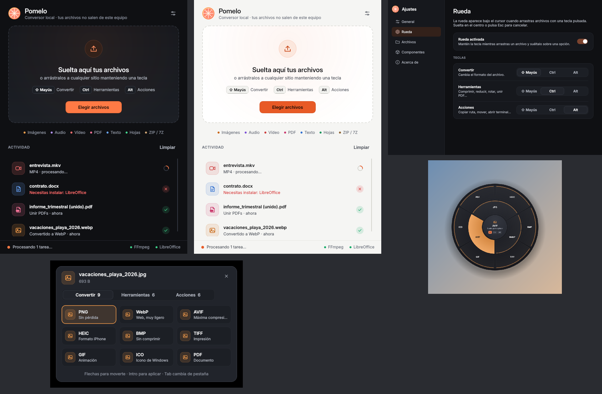

# Pomelo · conversor de archivos para Windows

Convierte imágenes, audio, vídeo, documentos y comprimidos arrastrándolos con una tecla pulsada.
Todo se procesa en tu equipo: no se sube nada a internet.



## Descarga

1. Ve a [**Releases**](../../releases/latest) y descarga `Pomelo-v0.2.0-windows-x64.zip`.
2. Descomprímelo donde quieras (por ejemplo en `Documentos\Pomelo`).
3. Abre `Pomelo.exe`.

> Windows SmartScreen puede avisar de que la app no está firmada. Pulsa **Más información → Ejecutar de todas formas**.
> Para convertir archivos de Word, Excel y PowerPoint instala también [LibreOffice](https://es.libreoffice.org/descarga/) (gratuito).

## Cómo se usa

1. Arranca Pomelo (`Pomelo.exe`, o `run.bat` desde el código). Aparece un icono naranja en la bandeja del sistema.
2. Empieza a arrastrar uno o varios archivos desde el Explorador o el escritorio.
3. Mientras arrastras, pulsa una tecla y aparece la **rueda** bajo el cursor:
   - **Mayús** → Convertir
   - **Ctrl** → Herramientas (comprimir, reducir, rotar, unir/dividir PDF, ZIP…)
   - **Alt** → Acciones (copiar ruta, copiar/mover a…, mostrar en carpeta, terminal, renombrar)
4. Suelta el archivo sobre una opción. Si lo sueltas en el centro, se cancela. Con **Esc** también se cancela.

El archivo nuevo se crea junto al original (o en la carpeta que elijas en Ajustes) y nunca se sobrescribe nada.

Otras formas de usarlo:
- Arrastra archivos a la ventana de Pomelo y elige una opción del menú.
- En **Ajustes → Añadir «Pomelo» al menú Enviar a** tienes *clic derecho → Enviar a → Pomelo* en el Explorador.

## Formatos

| Tipo | Entrada | Salida |
|---|---|---|
| Imágenes | JPG, PNG, WebP, HEIC, AVIF, BMP, TIFF, GIF, ICO, SVG | JPG, PNG, WebP, AVIF, HEIC, BMP, TIFF, GIF, ICO, PDF |
| Audio | MP3, M4A, AAC, WAV, FLAC, OGG, Opus, AIFF, WMA | MP3, M4A, WAV, FLAC, OGG, Opus, AIFF, WMA |
| Vídeo | MP4, MOV, MKV, WebM, AVI, WMV, FLV, MPG, 3GP, TS | MP4, MOV, MKV, WebM, AVI, WMV, GIF, MP3/M4A/WAV |
| PDF | PDF | PNG, JPG, DOCX, PPTX, TXT |
| Word/texto | DOCX, DOC, ODT, RTF · TXT, MD, HTML | PDF, DOCX, ODT, RTF, TXT, HTML, Markdown |
| Hojas de cálculo | XLSX, XLS, ODS, CSV, TSV | XLSX, CSV, TSV, ODS, PDF |
| Presentaciones | PPTX, PPT, ODP | PDF, PPTX, ODP, PNG, JPG |
| Subtítulos | SRT, VTT | SRT, VTT, TXT |
| Comprimidos | ZIP, 7Z, TAR, TAR.GZ, GZ | Extraer, ZIP, TAR.GZ, 7Z |

FFmpeg ya viene incluido. Para Word, Excel y PowerPoint hace falta [LibreOffice](https://es.libreoffice.org/descarga/) instalado (gratis). Sin él, esas opciones se ven en gris.

## Ejecutar desde el código

Necesitas Python 3.11 o superior (marca *Add python.exe to PATH* al instalarlo).

```bat
run.bat
```

La primera vez crea un entorno virtual `.venv` e instala las dependencias.

## Crear el .exe

```bat
build.bat
```

Genera `dist\Pomelo\Pomelo.exe`. Puedes comprimir la carpeta `dist\Pomelo` y llevarla a otro PC.

## Interfaz

- Ventana principal con zona de soltar, historial de actividad y estado de los componentes.
- Selector emergente con pestañas (Convertir / Herramientas / Acciones), navegable con el teclado.
- Rueda flotante con material oscuro, colores por tipo de archivo y animaciones suaves.
- Notificaciones propias en la esquina inferior derecha con acceso directo a la carpeta.
- Ajustes con barra lateral; tema claro, oscuro o el de Windows. Los cambios se guardan al momento.
- Respeta la opción de Windows «Mostrar animaciones».

Guía visual en `DESIGN.md`.

## Estructura

```
main.py                 punto de entrada
pomelo/app.py           bandeja, instancia única, notificaciones
pomelo/trigger.py       detección global de arrastre + tecla (Win32)
pomelo/overlay.py       rueda flotante
pomelo/window.py        ventana principal
pomelo/settings_dialog.py
pomelo/ui/               tema, iconos, controles, selector y notificaciones
pomelo/registry.py      modelo de operaciones
pomelo/ops/             conversores: images, media, documents, archives, actions
```

Para añadir un conversor nuevo basta con llamar a `register(...)` en un módulo de `pomelo/ops`.

Ajustes y log: `%APPDATA%\Pomelo\config.json` y `pomelo.log`.

## Licencia

MIT © 2026 Iván Sánchez
